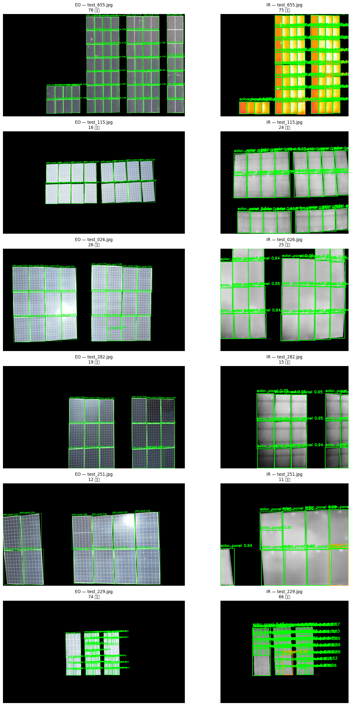

# Think in the Cloud, React at the Edge — ASUS-UGen-VLM

### Dual-Modal (RGB + Thermal IR) PV Defect Detection and Root-Cause Analysis on ASUS UGen300

> **Team ASV-PV-Inspector** | ASUS UGen AI League 2026
> **One pipeline, two phases:** heavy thinking happens once, offline — the edge only detects, fuses, and retrieves.

[](https://colab.research.google.com/drive/1t8fAJvJTvs8IVvYGcZohkxGd5TGmSHzd?usp=sharing)
[](https://github.com/ultralytics/ultralytics)
[](https://www.asus.com)
[](https://onnx.ai)


## Demo Video(https://youtu.be/CMVKnNm15r0)

---

## Demo — EO + IR Side-by-Side Comparison



*Generated by `solar_pipeline.py` §6 — 6 random test pairs, YOLOv8n detections per modality. Green = `solar_panel`, Red = `crack`, Orange = `hotspot`. The same scene is evaluated independently in EO and IR; fusion happens at scene level (no pixel alignment).*

---

## Overview

UAV patrol produces massive paired RGB + Thermal IR imagery. The bottleneck is **analysis throughput**, not capture. Field crews need not just a box, but a **root cause + recommended action** — knowledge that today lives in a few senior engineers and is not reproducible.

**ASUS-UGen-VLM** turns a **scene-paired EO + IR image pair** into:

* **Defect map** — polygon / bbox + class + confidence (`solar_panel`, `crack`, `hotspot` / `String Offline`)
* **Root cause + action** — deterministic, auditable Top-k retrieval from a versioned JSON Knowledge Base
* **Fully offline, real-time on a single ASUS UGen300 (Hailo-10H, 40 TOPS)** — NPU inference + CPU fusion/retrieval, **<1 s per scene**, no LLM at the edge, no network.

```
The VLM thinks in the cloud (once, offline); UGen300 reacts at the edge (always, offline).
```

This avoids on-device LLM hallucination, GB-scale memory, and seconds-per-item latency. Slides: `Asus/main.tex` (Beamer 15 frames + appendix, `pdfLaTeX`).

---

## Background and Motivation

* PV fleets keep expanding; **cracks, hot spots, offline strings** cause yield loss — hot spots pose **fire risk**.
* Manual inspection is slow, expensive, dangerous; cloud AI fails where there is **no internet and strict privacy**.
* **Detection ≠ diagnosis:** a box alone does not tell whether to *clean, replace a diode, or replace a module* — industry requires **explainable, reproducible** records for O&M and insurance.

## Dataset — As Organized in `Asus/`

| Split | Path | Content |
|-------|------|---------|
| **Train** | `9_16_train_set/train/{EO,IR}/{image,label}/` | 1,046 EO + 1,046 IR images (546 MB) + 2,092 Labelme JSONs |
| **Test** | `9_30_test_set/test/{EO,IR}/image/` | 696 EO + 696 IR images (423 MB), **no labels** |
| **Validator** | `9_16_train_set/make_submission.py` + `sample_submission.json` | `python make_submission.py --check submission.json` — exactly the scorer's validator |
| **Pipeline** | `solar_pipeline.py` | 9-stage single-file Colab script (≈ 18 KB) — install → convert → train → val → demo → submission → ONNX → Gradio |
| **Model** | `yolov8n.pt` | 6.2 MB COCO-pretrained base |
| **Artifacts** | `ugen-solar-defect-detection/` | Minimal deployable repo (`src/`, `models/best.pt`, `results/demo_eo_ir_comparison.png`, `requirements.txt`) |

* **Annotation:** Labelme `v5.8.3`, polygon `points: [[x,y],...]` (2–100 vertices), classes `solar_panel / crack / hotspot` (`String Offline` grouped with `hotspot` thermal pattern). `reason` text exists for anomalies in training only.
* **Pairing:** **Scene-level pairing only — no pixel alignment** (different resolution / viewpoint / coverage). `train_0001.jpg` in EO and IR share a scene ID but not a coordinate system.
* **Evaluation:** Composite `F1 = 0.7·F1_TIoU + 0.3·F1_TEXT` — polygon TIoU (all classes) + BERTScore F1 on instance-matched text.

```
Asus/
├── main.tex                        # slide deck (15 frames + appendix)
├── solar_pipeline.py               # ★ Colab one-cell pipeline
├── yolov8n.pt                      # base weights
├── demo_eo_ir_comparison.png       # 1428×2870 EO/IR demo
├── Demo.mp4                        # 4.0 MB demo video → assets/Demo.mp4 in repo
├── ugen-solar-defect-detection/    # deploy template
│   ├── requirements.txt
│   ├── models/best.pt
│   ├── results/demo_eo_ir_comparison.png
│   └── src/README.md
├── 9_16_train_set/
│   ├── make_submission.py
│   ├── sample_submission.json
│   └── train/{EO,IR}/{image,label}/  # 1,046 × 2
└── 9_30_test_set/test/{EO,IR}/image/  # 696 × 2
```

---

## Problem Definition — Three Subtasks

| # | Subtask | Input → Method | Output |
|---|---------|----------------|--------|
| **T1** | Defect detection & segmentation | EO / IR images → instance segmentation (YOLO) | polygon/bbox + class + confidence |
| **T2** | Cross-modal scene fusion | scene ID pairing (no pixel alignment) → evidence fusion | fused defect list + evidence vector |
| **T3** | Root-cause analysis | evidence vector → knowledge retrieval | ranked root causes + recommended actions |

**Hard constraints:**

* Fusion must be **late, scene-level** (pixel fusion impossible).
* Root-cause text exists **only in training** → evaluated via Top-k / BERTScore on matched instances.
* Edge must be **real-time and offline** → no on-device LLM.

---

## Solution Overview — One Pipeline, Two Phases

```
OFFLINE — one-time (Colab, link above)                UGen300 — online (real-time, offline)
┌─────────────────────────────────────────┐            ┌─────────────────────────────────┐
│ Model track:                            │            │ Paired EO+IR ─► 2× YOLO INT8     │
│  Train set ─► 2× YOLO (EO/IR) ─► ONNX   │            │ (NPU, parallel) ─► Fusion +     │
│  ─► INT8 PTQ ─► NPU weights (~6 MB)     │            │ key build (CPU) ─► KB lookup    │
│                                         │            │ O(1) + fallback ─► JSON report │
│ Knowledge track:                        │──JSON KB──►│ overlay map + work-order        │
│  Defect crops + ΔT/geom stats           │  (Git)     │ No network, no LLM              │
│  ─► LLaVA-7B 4-bit drafts (cloud)       │            └─────────────────────────────────┘
│  ─► Expert review ─► KB (~60–100)       │               <1 s / scene, KB-scale JSON
└─────────────────────────────────────────┘
```

*The same pipeline is implemented in two forms: `main.tex` (conceptual, YOLOv8s-seg) and `solar_pipeline.py` (executable, YOLOv8n merged EO+IR — see below).*

---

## T1 — Detection (Executable: `solar_pipeline.py`)

* **Single-model shortcut (pipeline):** merges EO+IR into one dataset (`yolo_dataset_merged`, prefix `EO_`, `IR_`) and trains **YOLOv8n** — fast to converge on Colab (20 epochs, batch 16, imgsz 640, freeze 10, mosaic 1.0, hsv, flip/rotate/scale). Dual-model YOLOv8s-seg ×2 is the slide-deck target; the pipeline demonstrates the same flow with one lightweight model for the demo.
* **Conversion:** `labelme_to_yolo_bbox()` → normalized `xc yc w h`; polygons clipped to image bounds; per-modality `train/val` split `85/15`.
* **Preprocessing:** IR pseudo-color → gray + optional **CLAHE**; SAHI tiling for large scenes (slide deck).
* **Modality–class prior:**

| Class | Primary modality | Why |
|-------|------------------|-----|
| crack | EO | visible texture |
| hotspot | IR | thermal anomaly |
| String Offline | IR | whole-string thermal pattern |
| solar_panel | both | object / background |

## T2 — Scene-Level Fusion

Since pixel alignment is unavailable, fuse **evidence, not pixels**:

* **Co-occurrence boost:** IR anomaly + EO damage in same scene → weighted confidence ↑.
* **IR-only:** thermal signal, normal EO → internal defect / String Offline.
* **EO-only:** visible crack, no heat → early-stage flag.

Fusion output = **KB key**: `(EO result, IR result) + (ΔT level, geometry pattern)` where `ΔT` is **relative** (vs. normal modules in same scene) to absorb camera/weather drift; pattern = `point / single-module / multi-module`.

## T3 — Hybrid Caching: Retrieve, Don't Generate

| Aspect | On-device LLM | **Hybrid caching (ours)** |
|--------|---------------|---------------------------|
| Latency | seconds / item | **<1 ms lookup** |
| Memory | GB-scale | **KB-scale JSON** |
| Output | stochastic / hallucinates | **deterministic, auditable** |
| Connectivity | model/API needed | **fully offline** |
| Update | retrain / redeploy | **edit JSON only** |

**Bounded key space:** `4 (EO) × 4 (IR) × 3 (ΔT) × 3 (pattern) = 144`; pruned to **~60–100 valid entries**, 100% covered by VLM drafting (LLaVA-7B 4-bit, cloud) + expert review.

```json
{
  "key": {"RGB": "Normal", "IR": "HotSpot", "dT": "High", "pattern": "single-module"},
  "root_causes": [
    {"cause": "Bypass-diode failure", "p": 0.55, "action": "Replace bypass diode"},
    {"cause": "PID effect", "p": 0.30, "action": "Check grounding"},
    {"cause": "Soiling / shading", "p": 0.15, "action": "Clean and re-inspect"}
  ],
  "source": "LLaVA draft + expert review", "kb_version": "v1.2"
}
```

**Lookup with graceful degradation:**

```python
key = (rgb_cls, ir_cls, dT_level, pattern)
if key in KB: return KB[key]
k2 = relax(key, "dT", 1)
if k2 in KB: return KB[k2] + flag("LOW-CONFIDENCE")
k3 = drop(key, "pattern")
if k3 in KB: return KB[k3] + flag("REVIEW")
return "UNKNOWN"  # → manual inspection queue (never guess)
```

Field feedback extends the KB via JSON edit — **zero retraining**, Git-versioned per-entry provenance.

---

## Quantization & UGen300 Deployment

```
PyTorch → ONNX (opset 13, simplify) → INT8 PTQ (UGen300/Hailo SDK, 100–500 calibration crops)
        → accuracy regression (<2% else QAT/FP16) → NPU weights
```

* **NPU:** EO/IR models run **in parallel** on Hailo-10H — target **15–30 FPS** per modality (pipeline demo: ~30 ms on UGen300).
* **CPU:** preprocessing (CLAHE, tiling), fusion, KB lookup, report rendering.
* **Constraints:** no dynamic shapes / exotic ops; SDK operator check required.
* **Size:** ~6 MB INT4/INT8 per modality; **entire chain on one device, no network, no LLM**.

`solar_pipeline.py` §8 exports `best.onnx` and validates with `onnxruntime` on a test image.

---

## Quick Start

### Option A — One-Click Colab (Recommended)

[](https://colab.research.google.com/drive/1t8fAJvJTvs8IVvYGcZohkxGd5TGmSHzd?usp=sharing)

1. Open the link above.
2. Upload `9_16_train_set/` and `9_30_test_set/` to `/content/` (or mount Drive and set `DATA_ROOT` / `TEST_ROOT`).
3. Copy-paste **entire** `solar_pipeline.py` into a single cell and run — it does all 9 stages: install → convert → merge → train (15–25 min on T4) → val → demo PNG → full-test submission → ONNX → Gradio.

```python
# top of solar_pipeline.py — adjust if needed
DATA_ROOT = "/content/9_16_train_set"
TEST_ROOT = "/content/9_30_test_set"
```

Outputs: `ugen_work/models/best.pt`, `ugen_work/results/val_run/`, `ugen_work/demo/demo_eo_ir_comparison.png`, `ugen_work/results/submission.json`.

### Option B — Local (UGen template)

```bash
git clone https://github.com/Mango5178/ASUS-UGen-VLM
cd ASUS-UGen-VLM
pip install -r ugen-solar-defect-detection/requirements.txt  # ultralytics torch opencv gradio onnx etc.
python solar_pipeline.py  # or split stages from ugen-solar-defect-detection/src/
python -m src.demo  # Gradio interactive: upload EO/IR → detections
```

### Submission check (same validator as scorer)

```bash
python 9_16_train_set/make_submission.py --template submission.json
python 9_16_train_set/make_submission.py --check submission.json
python 9_16_train_set/make_submission.py --check ugen_work/results/submission.json
```

---

## Architecture & Project Structure

```
ASUS-UGen-VLM/  (repo)
├── assets/
│   ├── Demo.mp4                      # 4.0 MB demo video (from Asus/Demo .mp4)
│   └── demo_eo_ir_comparison.png     # EO/IR side-by-side demo
├── README.md                         # this file (derived from Asus/main.tex + pipeline)
├── solar_pipeline.py                 # optional: copy from Asus/ for one-file Colab
└── ugen-solar-defect-detection/      # minimal edge-deploy scaffold
    ├── requirements.txt              # ultralytics torch opencv gradio onnx ...
    ├── models/best.pt                # trained YOLO weights
    ├── results/demo_eo_ir_comparison.png
    └── src/{train,inference,demo,export_onnx}.py
```

UGen300 runtime: `Preprocess (CPU) → 2× YOLO INT8 (NPU, parallel) → Fusion + key build (CPU) → KB lookup (CPU) → Report`.

---

## Expected Benefits & KPIs

| Metric | Target |
|--------|--------|
| mAP@0.5 (YOLOv8s-seg/n) | ≥ 0.70 |
| INT8 drop vs. FP32 | <2% |
| Throughput (per modality, UGen300) | ≥ 15–30 FPS |
| Root-cause Top-1 / Top-3 | ≥ 60% / 85% |
| BERTScore F1 (text) | ≥ 0.80 |
| End-to-end latency / scene | <1 s |

*Design targets (expected). Hybrid caching is ~100× faster and ~10,000× lighter than on-device LLM — fully offline.*

## Evaluation

`F1 = 0.7·F1_TIoU + 0.3·F1_TEXT`

* `F1_TIoU` (70%): polygon TIoU F1, all classes incl. `solar_panel`; penalizes missed/duplicate. Dual-modal + fusion + SAHI + copy-paste → **recall-first** lifts both terms.
* `F1_TEXT` (30%): **BERTScore F1** only on **instance-matched** anomalies; KB returns canonical phrasing → deterministic.

---

## Deliverables

* Dual-modal **INT8 models** for UGen300 (Hailo-10H)
* **JSON root-cause KB** (VLM drafts + expert-reviewed, versioned)
* End-to-end pipeline: `train → quantize → edge infer → fuse → lookup → report`
* **Live demo:** upload scene pair → defect overlay + root-cause card **in seconds** — see video & PNG above.

---

## Risks & Mitigations

| Risk | Mitigation |
|------|------------|
| INT8 drop >2% | QAT fine-tuning; FP16 fallback |
| ΔT drift across cameras/weather | per-scene relative normalization |
| Unseen key combination | fuzzy fallback + manual-review queue |
| Rare-class under-performance | copy-paste, class-weighted loss, SAHI |
| VLM draft quality | expert review gate; provenance & versioning |

---

## References

* G. Jocher et al., *Ultralytics YOLOv8*, 2023.
* H. Liu et al., *Visual Instruction Tuning (LLaVA)*, NeurIPS 2023, arXiv:2304.08485.
* P. Wang et al., *Qwen2-VL*, arXiv:2409.12191, 2024.
* F. C. Akyon et al., *Slicing Aided Hyper Inference*, ICIP 2022.
* P. Lewis et al., *Retrieval-Augmented Generation*, NeurIPS 2020.
* K. Wada, *labelme*. https://github.com/wkentaro/labelme
* ONNX. https://onnx.ai

---

## License

MIT — see `ugen-solar-defect-detection/LICENSE`.

> *Think in the cloud, react at the edge.*
